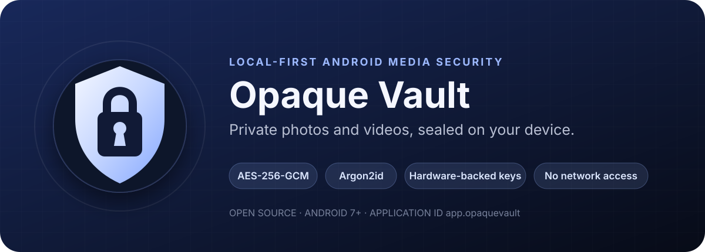

<p align="center">
  
</p>

<p align="center">
  <a href="https://github.com/zamin-naqvi/opaque-vault/releases/latest"></a>
  <a href="#build-from-source"></a>
  <a href="docs/ARCHITECTURE.md"></a>
  <a href="SECURITY.md"></a>
</p>

<p align="center">
  
  
  
  
  
</p>

<p align="center">
  <a href="#screenshots">Screenshots</a> ·
  <a href="#security-at-a-glance">Security</a> ·
  <a href="#feature-matrix">Features</a> ·
  <a href="#how-the-keys-fit-together">Cryptography</a> ·
  <a href="#threat-model">Threat model</a> ·
  <a href="#build-from-source">Build</a>
</p>

> [!IMPORTANT]
> **Opaque Vault is not published on Google Play.** Install only from this repository's [Releases](https://github.com/zamin-naqvi/opaque-vault/releases) page and verify the checksum and signing certificate below. There is no account recovery or developer backdoor.

Opaque Vault is a local-only photo and video vault for Android. It encrypts media before committing it to app-private storage, authenticates every read, keeps large files streaming, and deliberately ships without internet permission.

## Screenshots

<table>
  <tr>
    <td align="center" width="33%"><br><br><strong>Encrypted library</strong><br><sub>Photos, videos, search and encrypted thumbnails</sub></td>
    <td align="center" width="33%"><br><br><strong>Security controls</strong><br><sub>Hardware biometrics, NFC, duress and attestation</sub></td>
    <td align="center" width="33%"><br><br><strong>Verified export</strong><br><sub>Re-authentication, direct streaming and EXIF removal</sub></td>
  </tr>
</table>

<p align="center"><sub>Screenshots use synthetic emulator media. No personal files are included.</sub></p>

## Security at a glance

<table>
  <tr>
    <td width="33%"><strong>Per-item isolation</strong><br><sub>Every photo and video receives an independent random 256-bit file key.</sub></td>
    <td width="33%"><strong>Authenticated streaming</strong><br><sub>Large videos are encrypted in bounded AEAD segments—no plaintext staging file.</sub></td>
    <td width="33%"><strong>Hardware-bound master key</strong><br><sub>Passphrase material is combined with a non-exportable Android Keystore factor.</sub></td>
  </tr>
  <tr>
    <td><strong>Memory-hard unlock</strong><br><sub>Argon2id uses 64–256 MiB and three passes to raise offline guessing cost.</sub></td>
    <td><strong>Fail-closed operations</strong><br><sub>Imports and exports are verified; interrupted and unverified outputs are removed.</sub></td>
    <td><strong>Zero network surface</strong><br><sub>No internet permission, backend, analytics, advertising SDK or cloud account.</sub></td>
  </tr>
</table>

### What it does not do

Opaque Vault is not a hidden-folder trick and does not claim to make a compromised Android system trustworthy. It does not upload data, scan files in the cloud, or provide password recovery. Security-sensitive limitations are documented instead of being hidden behind marketing language.

## Feature matrix

| Area | Included |
|---|---|
| **Media** | Photos and videos, mixed Gallery shares, Photo Picker, file picker, search, sorting and configurable grid |
| **Playback** | Material 3 video player, seek, skip, speed, loop, mute, fit/fill and swipe navigation |
| **Export** | Gallery or chosen folder, passphrase re-authentication, SHA-256 verification, optional removal and photo EXIF stripping |
| **Backup** | Portable single-file streaming-encrypted backup and authenticated restore |
| **Privacy UI** | Private in-app keyboard, screenshot blocking, protected recents, overlay hiding, no autofill/content capture |
| **Disguise** | Calculator cover, launcher identity options and configurable unlocked title |
| **Defense** | Local permission/exposure audit, full vault integrity scan and configurable lock policies |

<details>
<summary><strong>Optional high-security controls</strong></summary>

All destructive and device-compatibility-sensitive controls are off until explicitly enabled.

- Hardware-bound biometric master-key envelope using `BiometricPrompt.CryptoObject`
- Dedicated NFC-tag possession factor
- Duress passphrase that destroys vault key material
- Official release-signature pinning
- Offline Android Keystore attestation inspection and optional strict verified-boot enforcement
- Shake/face-down panic lock or erase
- Configurable Quick Settings panic tile
- Dead-man erase checked at application start
- Android-Keystore-encrypted failed-attempt log
- Optional best-effort front-camera capture after failed unlock
- Configurable automatic erase threshold after repeated wrong passphrases

</details>

## How the keys fit together

```text
passphrase ── Argon2id ─┐
                        ├─ HKDF-SHA-256 ─ AES-256-GCM ─ master key
Android Keystore factor ┘
                                              │
                              ┌───────────────┴───────────────┐
                              │ wrapped random key per item    │
                              └────── AES-GCM-HKDF streaming ──┘
```

| Layer | Construction |
|---|---|
| Passphrase KDF | Argon2id v1.3 · 64–256 MiB · 3 iterations · 1–4 lanes |
| Master-key wrapping | HKDF-SHA-256 over independent passphrase/device factors, then AES-256-GCM |
| Device factor | AES-256 Android Keystore key; StrongBox requested when available |
| Media | Tink AES-256-GCM-HKDF streaming AEAD with 1 MiB authenticated segments |
| Metadata / thumbnails | AES-256-GCM with domain-separated associated data |
| Integrity records | Header HMAC-SHA-256 plus plaintext SHA-256 stored inside authenticated metadata |
| Portable backup | Streaming AEAD with separate Argon2id settings, up to 256 MiB and four passes |

Encryption and decryption are **O(n)** in file size. Passphrase verification has a fixed memory/time cost and does not grow with the number or size of vault items.

<a href="docs/ARCHITECTURE.md"></a>

## Download and verify

<a href="https://github.com/zamin-naqvi/opaque-vault/releases/download/v1.4/OpaqueVault-v1.4.apk"></a>

| Release detail | Value |
|---|---|
| Version | `1.4` (`versionCode 5`) |
| Application ID | `app.opaquevault` |
| Minimum Android | 7.0 / API 24 |
| APK SHA-256 | `d09cba53ac8183226ea6254e56e2f09f1f013169f8c7e0132ce7c17806672346` |
| Signing certificate SHA-256 | `2d1a07a0d65ede28d101005df2439dea2ecbf6da2647c1a1d3e578f75e275d85` |

The certificate fingerprint is public verification data—not a private signing key.

## Permissions

| Permission | Purpose |
|---|---|
| Camera | Optional failed-unlock photo; requested only when enabled |
| NFC | Optional enrolled-tag possession factor |
| Photos / videos | Locate and remove originals only when the user requests it |
| Manage media | Optional special access to reduce Android deletion prompts |
| Internet | **Not requested** |

## Threat model

**Designed for:** encrypted media copied from app storage, shared-storage browsing, ciphertext modification, offline password guessing and possession of a locked phone.

**Not a protection boundary:** hostile kernel/root control, an already-unlocked compromised OS, physical screen photography, or guaranteed physical erasure of flash cells. The NFC option verifies a salted tag identifier and is **not FIDO2 challenge-response**. Some tags can be cloned. Duress mode cannot promise perfect plausible deniability. Hardware attestation support varies by manufacturer.

> [!CAUTION]
> Forgetting the passphrase and losing access to the device-bound key makes the vault unrecoverable. Keep a tested encrypted backup before enabling destructive controls.

## Build from source

### Requirements

- Android Studio and JDK 17
- Android SDK 37
- No API key, service account or backend

```bash
git clone https://github.com/zamin-naqvi/opaque-vault.git
cd opaque-vault
./gradlew :app:assembleDebug
```

<details>
<summary><strong>Windows PowerShell</strong></summary>

```powershell
.\gradlew.bat :app:assembleDebug
```

</details>

The debug APK is written to `app/build/outputs/apk/debug/app-debug.apk`.

### Validation

```powershell
.\gradlew.bat clean :app:assembleDebug :app:lintDebug :app:assembleRelease --console=plain
```

Private signing material is intentionally absent. Clones build debug and unsigned release variants without it. Official local releases use an ignored `.private-signing/release-signing.properties` file when present. Never commit signing files, passwords or CI secrets.

R8 optimization is intentionally disabled. Obfuscation is not treated as a security boundary; predictable behavior is preferred for the cryptographic and media stack.

<details>
<summary><strong>Frequently asked questions</strong></summary>

### Why can passphrase unlock take a few seconds?

Argon2id deliberately spends memory and CPU on every attempt. This inconveniences the owner slightly while making high-volume offline guessing more expensive.

### Does unlock time depend on the amount of media?

No. Unlock cost is fixed by the KDF settings. Import, export and full integrity verification scale linearly with file size.

### Can the developer recover a forgotten passphrase?

No. There is no server account, escrow key or recovery endpoint.

### Has the project received an independent security audit?

Not yet. The implementation and threat model are public for review, but publication is not the same as a professional third-party audit.

</details>

## Project

- [Architecture](docs/ARCHITECTURE.md)
- [Security policy](SECURITY.md)
- [Contributing guide](CONTRIBUTING.md)
- [Releases](https://github.com/zamin-naqvi/opaque-vault/releases)
- [Issue tracker](https://github.com/zamin-naqvi/opaque-vault/issues)

Licensed under [Apache-2.0](LICENSE). Software is provided without warranty; review the implementation and threat model before trusting it with irreplaceable data.
