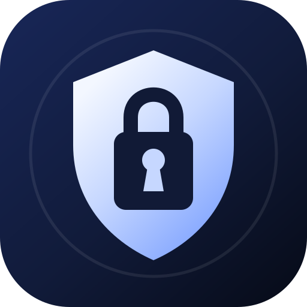
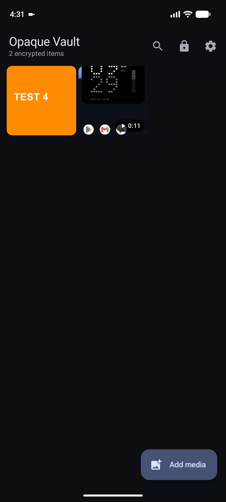
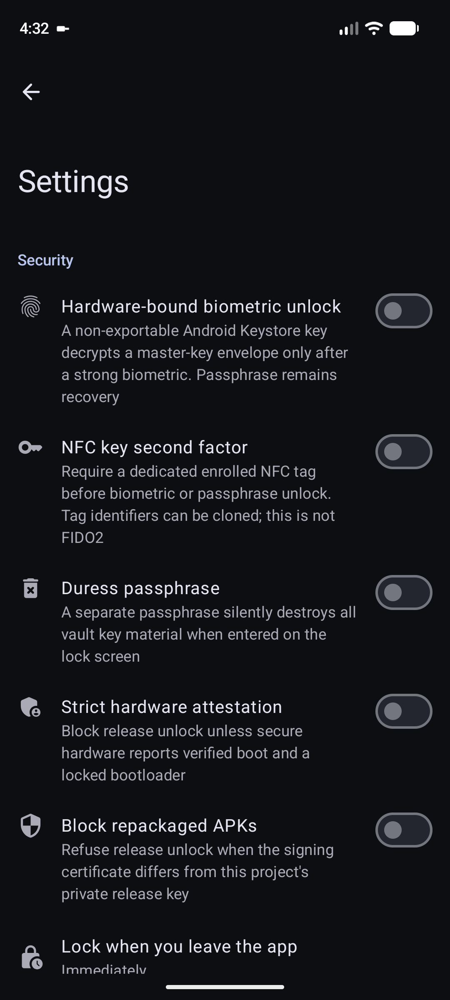
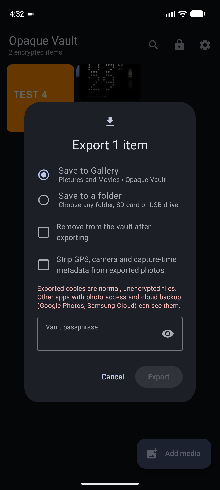

<p align="center">
  
</p>

<h1 align="center">Opaque Vault</h1>

<p align="center">
  A local-only photo and video vault for Android, built around authenticated encryption, hardware-backed key protection, and an explicit threat model.
</p>

<p align="center">
  
  
  
  
</p>

> **Distribution status:** Opaque Vault is not published on Google Play. APKs found outside this repository should not be trusted. Verify release signatures before installing.

## Screenshots

<table>
  <tr>
    <td align="center"><br><strong>Encrypted library</strong></td>
    <td align="center"><br><strong>Optional hardening</strong></td>
    <td align="center"><br><strong>Re-authenticated export</strong></td>
  </tr>
</table>

The screenshots contain synthetic emulator media. No personal files are included in this repository.

## Why this vault is different

Opaque Vault does not rely on a hidden folder, renamed files, or a database flag. Media is encrypted before it is committed to private app storage, and every read is authenticated. The application deliberately has no internet permission.

- **One random key per item.** Compromise or deletion of one wrapped item key does not expose the rest of the library.
- **Authenticated streaming encryption.** Large videos are processed in bounded segments without creating plaintext temporary files.
- **Two-part master-key protection.** The passphrase-derived key is combined with a non-exportable Android Keystore device factor.
- **Memory-hard passphrases.** Argon2id uses 64–256 MiB and three passes, selected from the device's available memory.
- **Tamper refusal.** Encrypted metadata, thumbnails, content segments, and the vault header are authenticated before use.
- **Fail-closed imports and exports.** Interrupted partial files are removed; completed copies are verified against SHA-256 records.
- **Private passphrase entry.** The app's keyboard does not create an Android input connection, keeping typed secrets away from third-party IMEs.
- **Secure presentation.** Release builds block screenshots, recents previews, content capture, autofill, overlays, and assistant extraction.
- **No recovery backdoor.** Losing both the passphrase and usable device key means losing the vault.

## Cryptographic design

```text
passphrase ── Argon2id ─┐
                        ├─ HKDF-SHA-256 ─ AES-256-GCM ─ master key
Android Keystore factor ┘
                                              │
                              ┌───────────────┴───────────────┐
                              │ wrapped random key per item    │
                              └────── AES-GCM-HKDF streaming ──┘
```

| Layer | Construction |
|---|---|
| Passphrase KDF | Argon2id v1.3, 64–256 MiB, 3 iterations, 1–4 lanes |
| Master-key wrapping | HKDF-SHA-256 over independent passphrase and device factors, then AES-256-GCM |
| Device factor | AES-256 key generated inside Android Keystore; StrongBox requested when available |
| Media | Tink AES-256-GCM-HKDF streaming AEAD with 1 MiB authenticated segments |
| Metadata and thumbnails | AES-256-GCM with domain-separated associated data |
| Integrity records | HMAC-SHA-256 for the vault header; SHA-256 plaintext digest stored inside authenticated metadata |
| Portable backup | Streaming AEAD with a separate Argon2id configuration (up to 256 MiB, 4 passes) |

Encryption and decryption are linear in file size, **O(n)**. Passphrase verification has a fixed memory/time cost and does not grow with the number or size of vault items.

See [docs/ARCHITECTURE.md](docs/ARCHITECTURE.md) for file formats, key lifetimes, and operation boundaries.

## Features

### Media

- Photos and videos, including mixed Gallery share batches
- Android Photo Picker, Storage Access Framework, and Gallery Share integration
- Search, configurable grid density, sorting, encrypted thumbnails, and in-memory image viewing
- Material 3 video player with seek, skip, speed, loop, mute, fit/fill, and swipe navigation
- Export to Gallery or a chosen folder with passphrase re-authentication
- Optional removal from the vault after a verified export
- Optional removal of GPS, camera identity, serial numbers, and capture timestamps from exported photos
- Single-file encrypted backup and restore

### Optional hardening

All destructive and compatibility-sensitive controls are off until the user explicitly enables them.

- Hardware-bound biometric master-key envelope using `BiometricPrompt.CryptoObject`
- NFC possession factor using a dedicated enrolled tag
- Duress passphrase that destroys vault key material
- Official release-signature pinning
- Offline Android Keystore attestation inspection and optional strict verified-boot enforcement
- Shake/face-down panic lock or erase
- Configurable Quick Settings panic tile
- Dead-man erase checked when the app starts
- Android-Keystore-encrypted failed-attempt log
- Optional best-effort front-camera capture after a failed unlock
- Full streaming integrity scan of every vault item
- Configurable automatic erase threshold after repeated wrong passphrases
- Calculator cover and changeable launcher identity

### Device privacy audit

The local audit reviews security-relevant Android configuration and apps visible through normal package-visibility rules: media permissions, accessibility services, notification listeners, overlay capability, device administrators, VPN state, ADB, screen lock, and update status. It does not upload data and does not claim to be an antivirus scanner.

## Threat model and limitations

Opaque Vault is designed to protect media at rest when an attacker copies app files, browses shared storage, or possesses a locked phone. It also raises the cost of offline passphrase guessing and detects many forms of ciphertext modification.

It cannot guarantee confidentiality after a hostile operating system, kernel, root process, or accessibility service controls an unlocked device. A camera can photograph the screen. Flash storage may retain old physical cells despite logical deletion. The NFC option verifies a salted tag identifier and is explicitly **not FIDO2 challenge-response**; specialist hardware may clone some tags. Duress erasure provides no perfect plausible deniability, especially after restart. Hardware attestation availability differs by manufacturer.

Read [SECURITY.md](SECURITY.md) before reporting a vulnerability.

## Permissions

| Permission | Why it exists |
|---|---|
| Camera | Optional failed-unlock photo; requested only when that feature is enabled |
| NFC | Optional enrolled-tag possession factor |
| Photos/videos | Requested when the user asks the app to locate and remove verified originals |
| Manage media | Optional Android special access to reduce per-file deletion prompts |
| Internet | **Not requested** |

## Build from source

Requirements:

- Android Studio with JDK 17
- Android SDK 37
- No service account, API key, or network backend

```bash
git clone https://github.com/zamin-naqvi/opaque-vault.git
cd opaque-vault
./gradlew :app:assembleDebug
```

On Windows PowerShell:

```powershell
.\gradlew.bat :app:assembleDebug
```

The debug APK is written to `app/build/outputs/apk/debug/app-debug.apk`.

### Release signing

Private signing material is intentionally absent. A clone can build debug and unsigned release variants without it. Official local release builds read `.private-signing/release-signing.properties` when that ignored file exists. Never commit a keystore, signing properties, passwords, or CI secrets.

Official v1.4 certificate SHA-256:

```text
2d1a07a0d65ede28d101005df2439dea2ecbf6da2647c1a1d3e578f75e275d85
```

A certificate fingerprint is public verification data; it is not a private key.

## Verification

```powershell
.\gradlew.bat clean :app:assembleDebug :app:lintDebug :app:assembleRelease --console=plain
```

The project intentionally leaves R8 optimization disabled. Obfuscation is not treated as a security boundary, and deterministic behavior is preferred for the cryptographic and media stack.

## Contributing

Start with [CONTRIBUTING.md](CONTRIBUTING.md). Security-sensitive changes should include a threat-model note and a reproducible validation path. Do not submit real media, credentials, private signing files, or device identifiers.

## License

Licensed under the [Apache License 2.0](LICENSE). This software is provided without warranty; review the code and threat model before trusting it with irreplaceable data.
